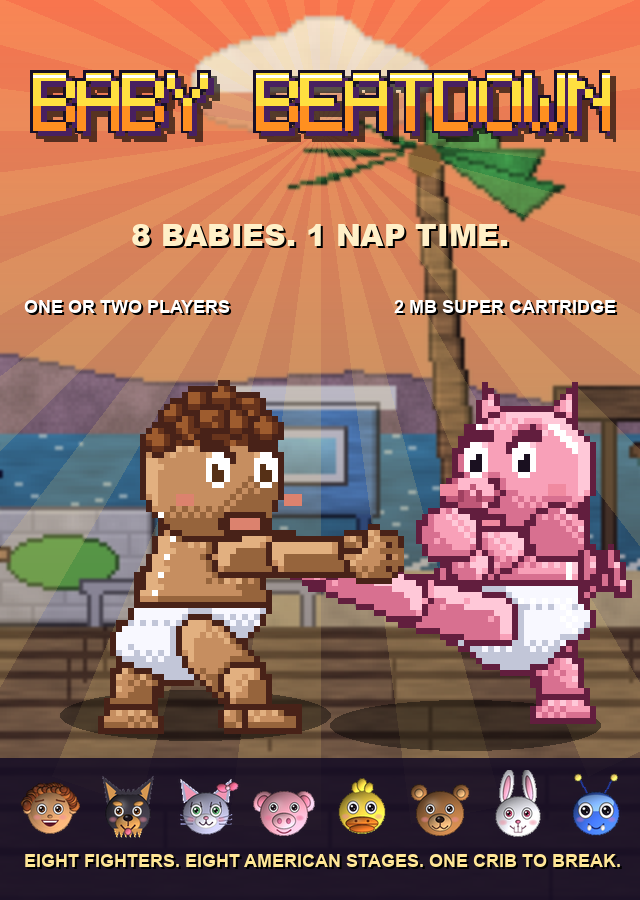
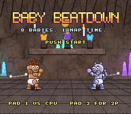
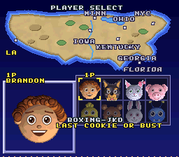
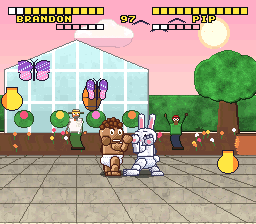
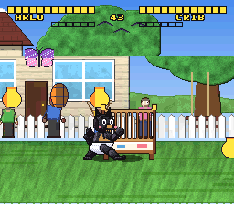

# Baby Beatdown

A Street Fighter II style fighting game for the Super Nintendo, written from scratch in 65816 assembly with
its own SPC700 sound driver. Eight babies, each an animal (plus one human and one bug) with its own martial
art, home stage somewhere in America, song, projectile, super, catchphrases and a grudge.

**Play it**: grab the latest ROM or zip package from the
[releases page](https://github.com/brandon-dacrib/baby-beatdown/releases) (every push to `main` builds and
publishes a semantically versioned release), or use `dist/baby-beatdown.sfc` (2 MB LoROM) straight from the
repository, in any accurate SNES emulator or on a flash cart.

| | |
|---|---|
|  |  |
|  |  |

## What is in it

- title screen with an attract mode that plays through the select screen and a CPU match
- player select on a map of the United States, one or two players
- eight scrolling 384-pixel stages painted in the SF2 recipe (sky, structures, big spectators, perspective
  floors) with parallax, water shimmer, birds, butterflies, candles, breathing palettes
- best-of-three rounds with ROUND / FIGHT / K.O. callouts, hit sparks, translucent shadows, combo counter
- chain combos, sweeps that knock down, breakable props, crouch shots, meter supers (projectiles and rushes)
  with their names called out, a break-the-crib bonus stage
- character bios: style, motivation on the select screen, win and lose lines at the match end
- nine songs and sixteen sound effects through a command-driven SPC700 driver

## The roster

| baby | species | style | home stage |
|---|---|---|---|
| Brandon | Creole kid, born in LA | boxing / Jeet Kune Do | Venice Beach boardwalk, Los Angeles |
| Arlo | terrier puppy | capoeira | a backyard in Ohio |
| Dawn | kitten | kung fu | a Brooklyn rooftop, New York City |
| Chris | piglet | sumo | a farm in Iowa |
| Isaac | duckling | taekwondo | a lake in Minnesota |
| Teddy | bear cub | wrestling | a cave in Kentucky |
| Pip | bunny | muay thai | a garden in Georgia |
| Blue | blue bug | karate | the Everglades, Florida |

Read [the story](docs/STORY.md) for who they are and why they are fighting, and [the manual](docs/MANUAL.md)
for controls, move lists and combo chains.

## Building

Homebrew `cc65` and `wla-dx`, Python 3 with numpy and pillow in `.venv`, then `make`. See
[NATIVE.md](NATIVE.md) for the engine layout, the data generators in `tools/`, and the Mesen2 headless test
harness. Everything on screen is generated from code and the small data files in `data/` and `render/`:
no Lua, no external art tools.

## License

Baby Beatdown is free software: code, art, music and data are released under the GNU General Public License
version 3 or later. See [LICENSE](LICENSE).

## Working rules

- `make` must produce a ROM that boots; verify changes with `tools/emu_test.py` before committing.
- Commit and push at the end of every work block.
